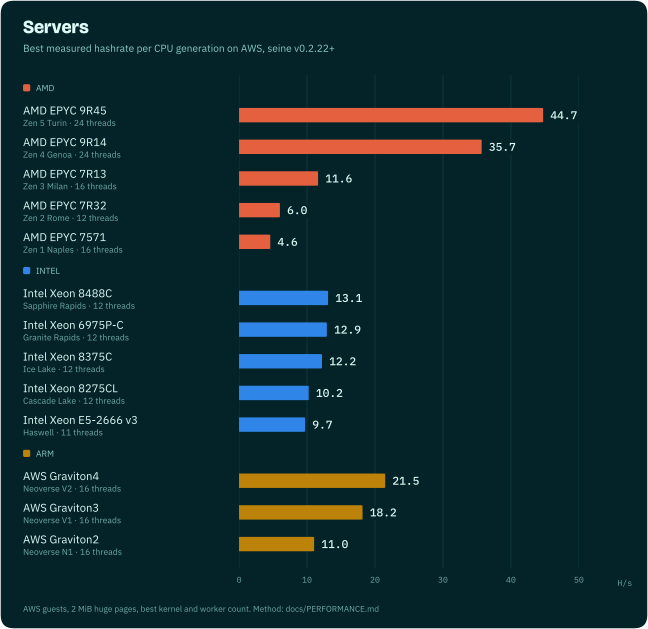
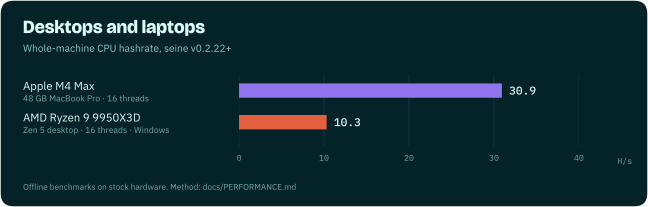

# Performance

Blocknet's proof of work is Argon2id with a 2 GiB arena per hash: it is
memory-hard, so hashrate depends as much on memory bandwidth and latency as on core
count. Seine ships hand-tuned kernels for each instruction set and picks the
fastest one for your machine while it mines.

Every number on this page is a measured result: completed hashes divided by the
actual elapsed time, including the end-of-round fence, from repeated runs. Evidence
for each row is linked, and chart data lives in
[`assets/charts/benchmarks.json`](assets/charts/benchmarks.json).

- [Cloud servers](#cloud-servers)
- [Desktops and laptops](#desktops-and-laptops)
- [Kernel comparisons](#kernel-comparisons)
- [Kernel coverage by CPU generation](#kernel-coverage-by-cpu-generation)
- [Benchmark your own machine](#benchmark-your-own-machine)
- [Method and limits](#method-and-limits)

A thread here is one hashing thread with its own 2 GiB arena, the same number you set
with `--threads` or see as "Threads" on the dashboard.

## Cloud servers



| CPU | Generation | Instance | Threads | Kernel | H/s |
|---|---|---|---:|---|---:|
| AMD EPYC 9R45 | Zen 5 Turin | m8a.8xlarge | 32 | streaming | 49.39 |
| AMD EPYC 9R14 | Zen 4 Genoa | m7a.8xlarge | 32 | streaming | 38.18 |
| AMD EPYC 7R13 | Zen 3 Milan | c6a.8xlarge | 16 | AVX2 | 11.63 |
| AMD EPYC 7R32 | Zen 2 Rome | c5a.8xlarge | 16 | AVX2 | 10.96 |
| AMD EPYC 7571 | Zen 1 Naples | m5a.8xlarge | 16 | AVX2 | 9.38 |
| Intel Xeon 8488C | Sapphire Rapids | m7i.8xlarge | 32 | streaming | 26.00 |
| Intel Xeon 6975P-C | Granite Rapids | m8i.8xlarge | 32 | streaming | 24.42 |
| Intel Xeon 8375C | Ice Lake | m6i.8xlarge | 32 | streaming | 24.32 |
| Intel Xeon 8259CL | Cascade Lake | m5n.8xlarge | 24 | streaming | 15.69 |
| Intel Xeon 8175M | Skylake | m5.8xlarge | 32 | streaming | 15.64 |
| Intel Xeon E5-2686 v4 | Broadwell | r4.8xlarge | 32 | AVX2 | 12.95 |
| AWS Graviton4 | Neoverse V2 | m8g.8xlarge | 32 | NEON + SHA3 | 39.29 |
| AWS Graviton3 | Neoverse V1 | m7g.8xlarge | 32 | NEON + SHA3 | 27.70 |
| AWS Graviton2 | Neoverse N1 | m6g.8xlarge | 30 | NEON | 18.63 |

Each row is the best configuration measured on that CPU: a 32-vCPU AWS instance
with explicit 2 MiB huge pages, swept across kernels and thread counts, four timed
runs at the winning setting. Raw results, per-run data and the method are in the
[readme-hardware campaign](../experiments/readme-hardware-20261025/README.md).

## Desktops and laptops



| Machine | Configuration | H/s | Evidence |
|---|---|---:|---|
| Apple M4 Max, 48 GB | 16 threads, `auto` affinity, CPU only | 30.94 | 2026-07-10 Mac sweep ([guide](guides/apple-silicon.md)) |
| Apple M4 Max, 48 GB | 14 threads, `pcore-only` (balanced) | 29.26 | three paired runs, 2026-07-10 |
| AMD Ryzen 9 9950X3D | 16 threads, native Windows, regular pages, streaming kernel | 10.31 | four alternating pairs, [high-end streaming](../experiments/high-end-streaming-20261025/RESULTS.md) |

NVIDIA GPUs mine at the same time as the CPU and their rates add up; see the
[NVIDIA guide](guides/nvidia.md).

## Kernel comparisons

Same machine, same thread count and page backing, alternating runs of two kernels.
Seine picks between them automatically while it mines:

| Machine | Change | Before | After | Gain |
|---|---|---:|---:|---:|
| AWS Graviton4 (Neoverse V2), 16 threads | NEON → runtime SHA3 + prefetch | 13.80 | 21.50 | +56% |
| AMD Ryzen 9 9950X3D, 16 threads | 256-bit AVX-512 → streaming | 7.07 | 10.31 | +46% |
| AWS Graviton3 (Neoverse V1), 16 threads | NEON → runtime SHA3 + prefetch | 12.52 | 18.17 | +45% |
| AMD EPYC 9R45 (Zen 5 Turin), 24 threads | AVX2 → streaming | 34.47 | 44.74 | +30% |
| AMD EPYC 9R14 (Zen 4 Genoa), 24 threads | AVX2 → streaming | 28.07 | 35.70 | +27% |
| AWS Graviton2 (Neoverse N1), 16 threads | portable NEON tuning | 10.61 | 11.05 | +4% |

Evidence: [CPU campaign results](../experiments/cpu-campaign-20261024/RESULTS.md),
[EPYC integration](../experiments/epyc-investigation/INTEGRATED_VALIDATION.md),
[high-end streaming](../experiments/high-end-streaming-20261025/RESULTS.md).

## Kernel coverage by CPU generation

Seine's x86 builds carry scalar, AVX2 and AVX-512 kernels plus a streaming-store
variant, and Arm builds carry NEON with a SHA3 fast path. Automatic tuning compares
them while mining and only switches after two confirmed gains. Recent paired
measurements on real hardware, one generation per row:

**AMD EPYC**

| Generation | Tested CPU | Result |
|---|---|---|
| Zen 1 (Naples) | EPYC 7571 | Paired-column AVX2 kernel: +11–16% |
| Zen 2 (Rome) | EPYC 7R32 | Paired-column AVX2 kernel: +10–34% |
| Zen 3 (Milan) | EPYC 7R13 | Paired-column AVX2 kernel: +3–14% |
| Zen 4 (Genoa) | EPYC 9R14 | Streaming kernel: +27% at 24 threads |
| Zen 5 (Turin) | EPYC 9R45 | Streaming kernel: +30% at 24 threads; AVX-512 +15–20% at one thread |

**Intel Xeon**

| Generation | Tested CPU | Result |
|---|---|---|
| Broadwell | Xeon E5-2686 v4 | Paired-column AVX2 kernel: +11–12% |
| Cascade Lake | Xeon 8275CL | AVX-512 over AVX2: +17–19% |
| Ice Lake | Xeon 8375C | AVX-512 over AVX2: +21–29% |
| Sapphire Rapids | Xeon 8488C | AVX-512 over AVX2: +7–9% |
| Granite Rapids | Xeon 6975P-C | AVX-512 over AVX2: +6–7% |

**Arm**

| Generation | Tested CPU | Result |
|---|---|---|
| Neoverse N1 | Graviton2 | Portable NEON: +4% |
| Neoverse V1 | Graviton3 | SHA3 + prefetch: +45% |
| Neoverse V2 | Graviton4 | SHA3 + prefetch: +56% |

Ranges span one to four threads with regular and huge pages. Full tables, thread
counts and confidence intervals are in the
[architecture matrix](../experiments/cpu-architecture-20261024/README.md).

## Benchmark your own machine

Offline benchmarks need no daemon or pool:

```bash
# Whole-machine CPU benchmark with default settings
./seine --bench --bench-kind backend --backend cpu --bench-secs 20 --bench-rounds 3

# Compare kernels at a fixed thread count
./seine --bench --bench-kind backend --backend cpu --threads 8 \
  --disable-cpu-autotune-threads --bench-cpu-kernel avx2 --bench-secs 20 --bench-rounds 3
```

`--bench-cpu-kernel` accepts `scalar`, `avx2`, `avx512`, `avx512-256`,
`avx512-256-stream`, `neon` and `neon-sha3`, subject to CPU support. For statistically paired
A/B comparisons, use the [benchmark lab](benchmarks.md).

## Method and limits

- Cloud results are AWS EC2 guests. A VM exposes a slice of a physical host; memory
  bandwidth share, SMT exposure and topology vary by instance type. They describe
  that guest, not a whole bare-metal socket.
- Desktop results are single machines in a stated configuration. Your RAM speed,
  cooling and background load will move the numbers.
- Huge pages, thread count and CPU placement all change which kernel wins, which is
  why seine measures on your machine instead of hard-coding a choice. See the
  [hardware guides](../README.md#get-the-most-from-your-hardware).
- Multi-socket NUMA servers have not been benchmarked yet.

Tuning history: [CPU optimization log](../CPU_OPTIMIZATION_LOG.md) ·
[NVIDIA optimization log](../NVIDIA_OPTIMIZATION_LOG.md).
