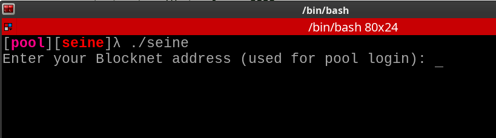
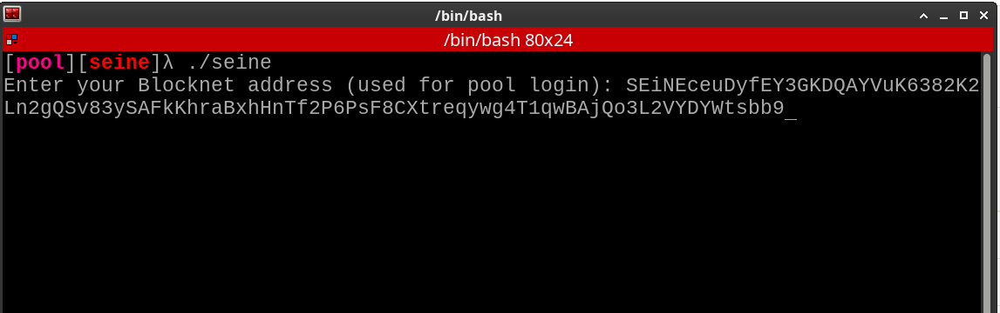

# Setup and configuration

Running `./seine` with no flags is the recommended path. The default mode is
**pool** mining.

## First run

On first startup Seine:

- asks for your Blocknet payout address or Blocknet ID shortname (`@name` or `$name`)
- asks for a pool URL (default `stratum+tcp://bntpool.com:3333`) and worker name
- enables every available backend (CPU, plus NVIDIA GPUs when present)
- sizes CPU threads from your cores and RAM, then keeps tuning while it mines

1. Enter your payout address or registered shortname:

   

2. Confirm it before continuing (shortnames need Seine v0.2.16 or newer):

   

3. Enter your pool endpoint and worker, then start mining:

   

These values are saved in `./seine-data/seine.config.json` (`--data-dir` changes the
base directory).

## Common flags

All flags are documented in the [flag reference](../MINER_FLAGS.md).

```bash
# Pool settings
./seine --address PpkFxY...
./seine --address '@yourname'
./seine --pool-url stratum+tcp://pool.example.com:3333
./seine --pool-worker rig-01

# Set the CPU thread count explicitly (disables thread autotuning)
./seine --threads 4

# Choose backends (auto-detected by default)
./seine --backend cpu
./seine --backend nvidia
./seine --backend cpu,nvidia

# Plain log output instead of the dashboard
./seine --ui plain
```

## Pool connections

Seine works with any Blocknet pool that speaks the Blocknet Stratum protocol,
which is what Blocknet pools run.

```bash
# Encrypted connection, when the pool offers a TLS port
./seine --pool-url stratum+ssl://pool.example.com:3443

# Backup pools, tried in order
./seine --pool-url stratum+tcp://pool.example.com:3333 \
        --pool-url stratum+tcp://backup.example.com:3333

# The short form many mining OS templates use
./seine -o pool.example.com:3333 -u YOUR_ADDRESS.rig-01 -p x
```

- **TLS.** `stratum+ssl://` and `stratum+tls://` encrypt the connection. When you
  name the pool by hostname, Seine checks its certificate like a browser does. When
  you name it by IP address, the connection is encrypted without the name check,
  which also suits pools whose certificate does not match the address you use.
- **Failover.** List several pools with repeated `--pool-url` flags or commas
  (`a:3333,b:3333`). If Seine cannot connect to or log in to a pool after two
  tries, it moves to the next one. While on a backup it checks the first pool
  every few minutes and switches back between shares once that pool answers.
  The saved config keeps the whole list.
- **Proxy.** `--pool-proxy socks5://host:port` reaches every pool through a
  SOCKS5 proxy, for networks that block mining ports. Add `user:pass@` before the
  host if the proxy needs a login. Tor (`socks5://127.0.0.1:9050`) and an SSH tunnel
  (`ssh -D 1080 yourserver`, then `socks5://127.0.0.1:1080`) both work. Only pool
  connections use the proxy; pool stats and update checks connect directly.
- **Login.** `-u ADDRESS.WORKER` sets the payout address and worker name together;
  `--pool-worker` overrides the worker part. `-p` is accepted and ignored, because
  Blocknet pools do not use passwords.

## Dashboard controls

Press `+` or `-` directly in the mining dashboard to add or remove one thread
per CPU backend. The hint appears beside the thread count; `=` also increases
the count without requiring Shift. Each change applies immediately. All mining
backends restart and pool mining reconnects, while session statistics, uptime,
average hashrate, and dashboard history are preserved. The
current hashrate refreshes for the new workers. Further changes are ignored
until the restart finishes. The selected count disables CPU autotuning for that
run and is not saved as a new default.
Increases are limited to the automatic CPU/RAM cap; use `--threads` for explicit
startup overrides.

Short terminal windows use a compact dashboard that keeps the CPU thread count,
mining state, and hashrate visible. Press `q` or `Ctrl+C` to quit.

Seine checks GitHub for a newer release at startup and every 12 hours. When one
exists, the dashboard header shows `update vX.Y.Z available` and the log gets
one line with the download link (plain and API modes log the same line). The
check never interrupts mining; pass `--disable-update-check` to turn it off.

On Windows, a fatal error after double-clicking `seine.exe` with no arguments
leaves its console open until you press Enter. Launches from an existing shell,
invocations with arguments, and redirected input/output do not pause.

## Blocknet ID shortnames

`--address`, the first-run prompt, saved config, and the control API's
`mining_address` accept shortnames (`@name` or `$name`) in both pool and daemon
mode. Quote `$name` in shells that expand variables.

Seine verifies the signed mapping from `https://blocknet.id` and validates the
address before mining. The resolved address is logged and stays fixed for that
run, including reconnects; saved shortnames are resolved again on the next run.
Unknown names, resolver failures, invalid signatures and invalid addresses stop
startup. Full addresses work without contacting the resolver.

## Dev fee

Seine's dev fee is a flat **2% of mining time**, on every pool and in solo mode.
It funds continued miner development. The first 10 minutes of each run are fee-free.
Dev-fee rounds mine on bntpool.com; if your network cannot reach it, they mine on
your own pool instead, so the miner never sits idle.

## Control API

Seine exposes a local REST + SSE control API and Prometheus metrics for dashboards
and fleet tooling:

```bash
# Idle until started over the API
./seine --service --api-bind 127.0.0.1:9977

# Mine immediately and expose the API
./seine --api-server --api-bind 127.0.0.1:9977
```

Full guide: [Control API](../API.md) · [OpenAPI spec](../openapi/seine-api-v1.yaml).
